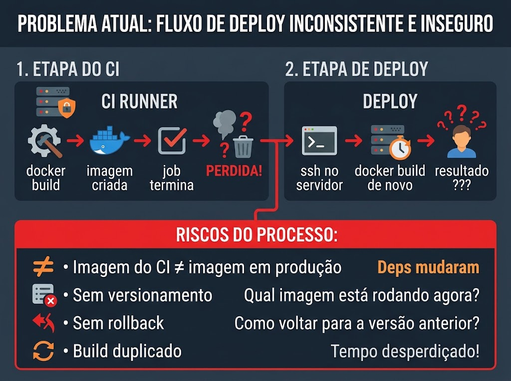
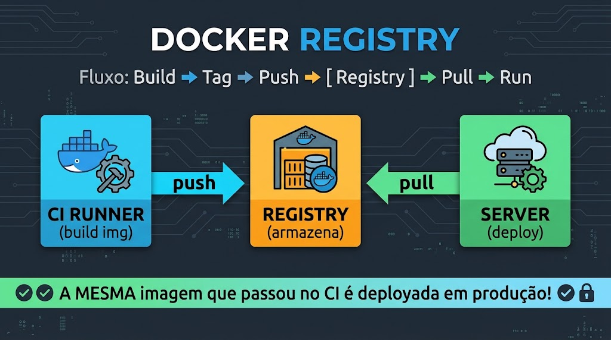
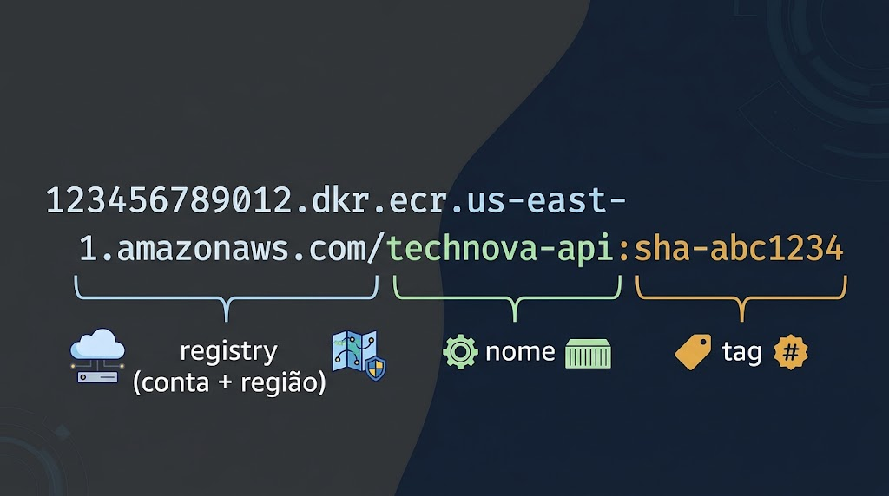
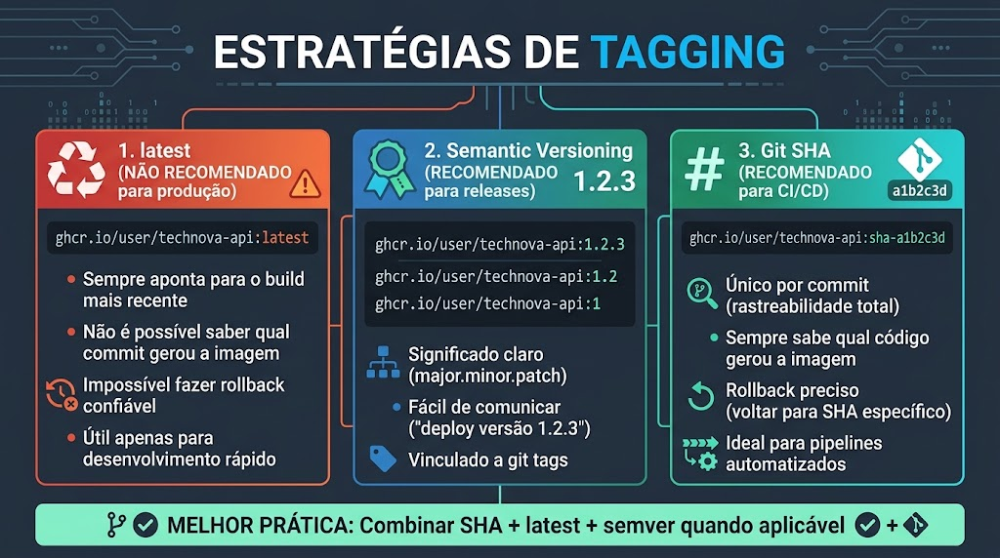
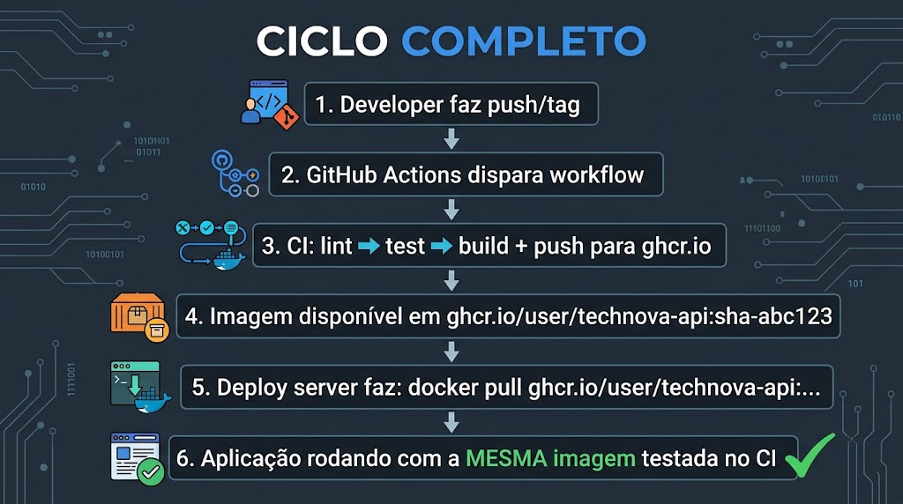
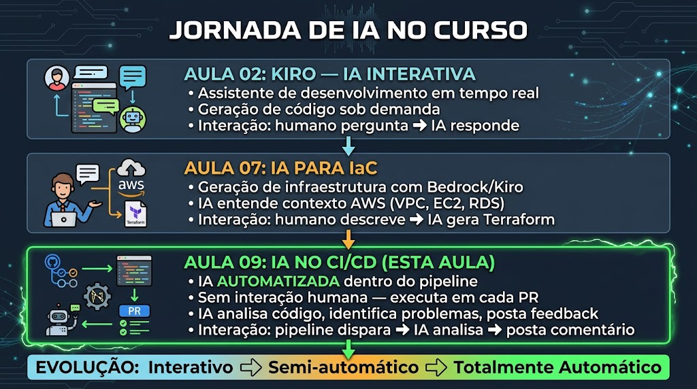
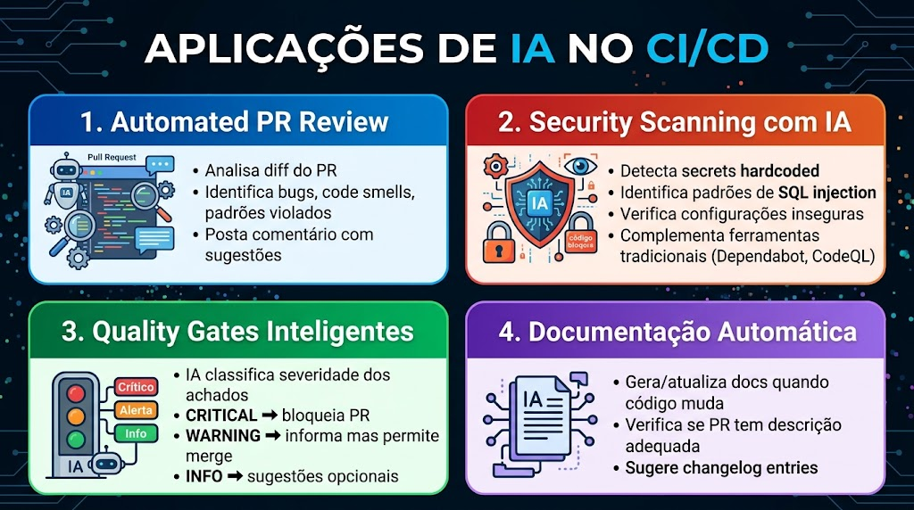
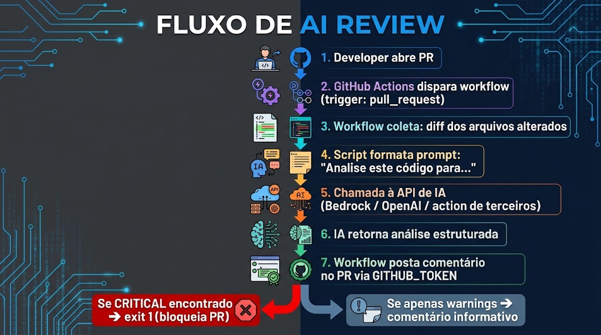
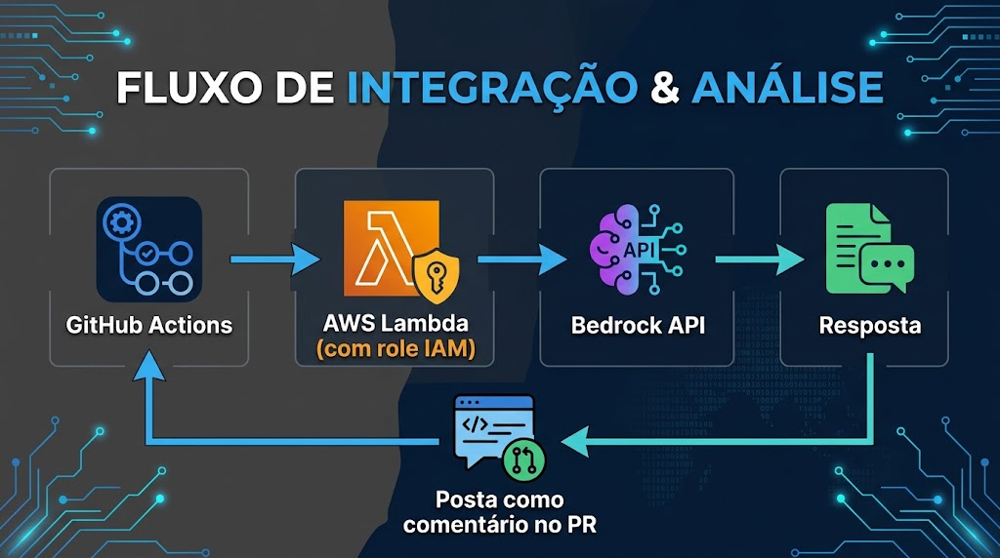

# Aula 09 — Trabalho Anterior (TA)

## Objetivo

Preparar-se para a Aula 09 através de leitura prévia sobre **Docker Registry** e **IA no CI/CD**. Nesta aula você vai fechar o ciclo do pipeline: além de verificar o código (lint/test/build da Aula 08), vamos **publicar a imagem Docker versionada** num registry e colocar uma **IA revisando cada Pull Request** automaticamente. Ao final da leitura, você deve entender *por que* a imagem precisa sair do runner, *como* versioná-la com rastreabilidade e *qual* o papel (e os limites) da IA dentro do pipeline.

> **Como estudar este material:** leia as duas partes, observe as figuras (elas resumem o fluxo que você vai implementar no laboratório) e responda as questões de verificação ao final. Traga suas respostas e dúvidas para a discussão no início da aula.

---

## Parte 1 — Docker Registry

### 1.1 O Problema: Imagens Presas no Runner

Na Aula 08, o pipeline CI já builda a imagem Docker para provar que o `Dockerfile` compila. Mas há uma armadilha silenciosa: **a imagem nasce e morre dentro do runner do GitHub Actions**. Quando o job termina, a VM é destruída e a imagem some junto.



Isso gera quatro problemas concretos para a TechNova:

| Problema | O que acontece na prática |
|----------|---------------------------|
| **Não reproduzível** | Buildar de novo no servidor pode gerar imagem diferente (uma dependência "flutuante" foi atualizada entre o CI e o deploy) |
| **Não versionável** | Ninguém sabe responder "qual imagem exata está rodando em produção agora?" |
| **Não compartilhável** | Outro dev (ou o servidor de deploy) não consegue obter *a mesma* imagem que passou no CI |
| **Sem rollback** | Se o deploy quebra, não existe "a versão de ontem" guardada em lugar nenhum |

A regra de ouro do delivery de containers:

> **Build once, run anywhere.** A imagem é construída **uma vez** (no CI), publicada num registry e, a partir daí, **apenas puxada** (pull) por qualquer servidor. O que foi testado é exatamente o que vai para produção — bit a bit.

A solução para tudo isso é um **Docker Registry**.

### 1.2 O que é um Docker Registry?

Um Docker Registry é um **repositório centralizado** que armazena e distribui imagens Docker versionadas. Pense nele como o **npm para pacotes Node.js**, mas para imagens de container.



As três operações fundamentais:

- **Push** — envia uma imagem buildada do CI (ou da sua máquina) para o registry
- **Pull** — baixa uma imagem do registry para executar em qualquer servidor
- **Tag** — rótulo que identifica uma versão específica da imagem

O fluxo completo de ponta a ponta:

```
docker build  →  docker tag  →  docker push  →  [ REGISTRY armazena ]  →  docker pull  →  docker run
   (CI)            (CI)           (CI)                                       (servidor)     (servidor)
```

A separação é a chave: **quem builda (CI) não é quem executa (servidor)**. O registry é a ponte confiável entre os dois.

### 1.3 Opções de Registry

Existem vários registries no mercado. Os mais comuns:

| Registry | Provedor | Custo (público) | Quando usar |
|----------|----------|:---------------:|-------------|
| **Docker Hub** | Docker Inc. | Grátis (público); 1 repo privado grátis | Padrão universal, imagens open source |
| **ghcr.io** | GitHub | **Grátis e ilimitado** | Código já está no GitHub |
| **Amazon ECR** | AWS | ~$0.10/GB/mês | Infra já roda na AWS (**nosso caso no Learner Lab**) |
| **Azure ACR** | Microsoft | ~$5/mês (Basic) | Ecossistema Azure |
| **Google Artifact Registry** | GCP | Grátis até 500 MB | Ecossistema GCP |

Formato da URL de cada um (repare que todos seguem a mesma anatomia):

```
docker.io/usuario/imagem:tag                                 ← Docker Hub
ghcr.io/usuario/imagem:tag                                   ← GitHub
123456789012.dkr.ecr.us-east-1.amazonaws.com/imagem:tag      ← AWS ECR
```

**Por que Amazon ECR neste curso?**
- **Mesmo ecossistema AWS** — o Learner Lab já é AWS; a imagem fica ao lado de onde ela vai rodar (EC2/ECS/EKS nos próximos módulos)
- **Registry privado por padrão** — controle de acesso via IAM/credenciais da conta, sem expor a imagem publicamente
- **Scan de vulnerabilidades integrado** — o ECR pode escanear cada imagem no push
- **Preparação para produção real** — ECR é o registry que empresas que rodam na AWS de fato usam

> **☁️ Estamos no AWS Academy Learner Lab.** Isso traz três regras que valem para toda a aula:
> 1. **Credenciais temporárias** — a sessão do Lab fornece `aws_access_key_id`, `aws_secret_access_key` **e** `aws_session_token`. Elas **expiram quando a sessão do Lab encerra** — ao reabrir, recarregue as credenciais.
> 2. **Região fixa `us-east-1`** — todo o trabalho acontece nela.
> 3. **Nada de IAM** — o Lab **não permite** criar usuários, grupos ou roles IAM. Mas **permite criar repositórios ECR** e usar a role pré-existente `LabRole` para serviços. Por isso a autenticação usa as credenciais da própria sessão, não um usuário dedicado.

### 1.4 Anatomia de uma Imagem (Nomenclatura)

Antes de versionar, é preciso entender como se "endereça" uma imagem. Cada parte do nome tem um papel:



Exemplo real no ECR: `123456789012.dkr.ecr.us-east-1.amazonaws.com/technova-api:sha-abc1234`

| Parte | Valor no exemplo | Significado |
|-------|------------------|-------------|
| **Registry (host)** | `123456789012.dkr.ecr.us-east-1.amazonaws.com` | Onde a imagem está armazenada — **inclui o seu Account ID e a região** |
| **Repositório** | `technova-api` | Nome do repositório ECR (criado antes do primeiro push) |
| **Tag** | `sha-abc1234` | Versão específica |

> **Diferença-chave vs ghcr.io:** no ghcr.io o host é fixo (`ghcr.io`) e o owner vem no caminho (`ghcr.io/owner/img`). No ECR o **host já identifica a sua conta e a região** (`<ACCOUNT_ID>.dkr.ecr.us-east-1.amazonaws.com`), e o repositório vem logo em seguida. Troque `123456789012` pelo seu Account ID real (veja com `aws sts get-caller-identity`).

Se você omite o registry (`technova-api:latest`), o Docker assume `docker.io`. Se omite a tag, assume `:latest`. Por isso ser explícito importa — ambiguidade em produção causa incidentes.

### 1.5 Estratégias de Tagging

A **tag** é o que diferencia uma versão da imagem de outra. Escolher a estratégia errada é uma das causas mais comuns de "funciona no meu ambiente, mas não em produção".



**1. Tag `latest`**
- Sempre aponta para o build mais recente
- ❌ Problema: não diz *qual commit* gerou a imagem
- ❌ Problema: `docker pull :latest` pode trazer conteúdo diferente a cada vez
- ✅ Uso: desenvolvimento rápido local — **nunca em produção**

**2. Semantic Versioning (semver)**
- Formato: `major.minor.patch` (ex.: `1.2.3`)
- `major` = mudança incompatível, `minor` = nova feature compatível, `patch` = correção
- Vinculado a git tags: `git tag v1.2.3` → gera a imagem `:1.2.3`
- ✅ Uso: releases oficiais e comunicação com a equipe ("subimos a 1.2.3")

**3. Git SHA (hash do commit)**
- Formato: primeiros 7 caracteres do commit (ex.: `sha-a1b2c3d`)
- **Único por commit** — rastreabilidade total: toda imagem aponta para o código exato que a gerou
- ✅ Uso: pipelines automatizados e rollback preciso

**Melhor prática — combine as três:**

```
<ACCOUNT_ID>.dkr.ecr.us-east-1.amazonaws.com/technova-api:sha-a1b2c3d  ← TODO push (rastreável, imutável)
<ACCOUNT_ID>.dkr.ecr.us-east-1.amazonaws.com/technova-api:latest       ← só na branch main (conveniência)
<ACCOUNT_ID>.dkr.ecr.us-east-1.amazonaws.com/technova-api:1.2.3        ← quando há git tag v1.2.3 (release)
```

Assim você tem conveniência (`latest`), comunicação (`1.2.3`) e rastreabilidade/rollback (`sha-...`) ao mesmo tempo.

### 1.6 Multi-Stage Builds para o Registry

Já vimos multi-stage na Aula 08. No contexto de registry, ele importa ainda mais, porque **imagem menor = push/pull mais rápido e menos superfície de ataque**.

```dockerfile
# Estágio 1 — builder: instala dependências de produção
FROM node:20-alpine AS builder
WORKDIR /app
COPY package*.json ./
RUN npm ci --only=production && npm cache clean --force

# Estágio 2 — runtime: imagem final enxuta, só o necessário
FROM node:20-alpine AS runtime
WORKDIR /app
RUN addgroup -g 1001 -S nodejs && adduser -S technova -u 1001 -G nodejs
COPY --from=builder /app/node_modules ./node_modules
COPY . .
USER technova
EXPOSE 3000
CMD ["node", "server.js"]
```

Por que isso vale no CI/CD:
- **Imagem final 3–5x menor** (sem devDependencies nem cache do npm) → menos dados no push
- **Menos superfície de ataque** → nenhuma ferramenta de build fica na imagem de produção
- **Cache de layers** → steps que não mudaram não são re-executados, build mais rápido

### 1.7 Criar o Repositório, Autenticar e Publicar no ECR

Diferente do ghcr.io (onde o repositório surge no primeiro push), no ECR você **cria o repositório antes**. No Learner Lab isso é permitido com as credenciais da sessão. São três passos:

**1. Criar o repositório (uma vez)**

```bash
aws ecr create-repository \
  --repository-name technova-api \
  --region us-east-1
```

**2. Autenticar o Docker no ECR**

O ECR não usa usuário/senha fixos: você pede um token temporário à AWS e passa para o `docker login`. O usuário é sempre literalmente `AWS`:

```bash
ACCOUNT_ID=$(aws sts get-caller-identity --query Account --output text)
REGISTRY="${ACCOUNT_ID}.dkr.ecr.us-east-1.amazonaws.com"

aws ecr get-login-password --region us-east-1 \
  | docker login --username AWS --password-stdin "$REGISTRY"
```

**3. Build, tag e push**

```bash
docker build -t technova-api .

# tag com SHA do commit + latest
SHA=$(git rev-parse --short HEAD)
docker tag technova-api "$REGISTRY/technova-api:sha-$SHA"
docker tag technova-api "$REGISTRY/technova-api:latest"

docker push "$REGISTRY/technova-api:sha-$SHA"
docker push "$REGISTRY/technova-api:latest"
```

> **Por que um script local (`ecr-push.sh`) é o fluxo principal, e não o CI?** As credenciais do Learner Lab são **temporárias e expiram a cada sessão**, e o Lab **não permite OIDC nem criar roles IAM** para o GitHub Actions assumir. Rodar o push a partir da sua máquina (ou do Lab) com as credenciais atuais é o caminho confiável. No laboratório você empacota esses três passos num `ecr-push.sh`. O CI com `aws-actions/amazon-ecr-login` é opcional e exige colar as 3 credenciais temporárias como secrets — que precisam ser renovadas a cada sessão.

### 1.8 Ciclo de Vida da Imagem e Console do ECR

Depois do push, a imagem passa a existir **fora do runner** — versionada e pronta para qualquer servidor fazer pull. Esse é o ciclo completo que fecha o gap da Aula 08:



A imagem publicada aparece no **console do Amazon ECR** (Elastic Container Registry → Repositories → `technova-api`):
- Mostra todas as tags (`sha-...`, `latest`, semver), o tamanho e a data de push
- Pode exibir o resultado do **scan de vulnerabilidades**, se habilitado no repositório
- Qualquer servidor com credencial válida puxa com: `docker pull <ACCOUNT_ID>.dkr.ecr.us-east-1.amazonaws.com/technova-api:1.0.0` (após o mesmo `docker login` do passo 2)

E o **rollback** vira trivial — basta apontar o deploy para uma tag anterior:

```bash
# Produção quebrou na 1.0.1? Volte para a 1.0.0 em segundos:
docker pull "$REGISTRY/technova-api:1.0.0"
docker run -d -p 3000:3000 "$REGISTRY/technova-api:1.0.0"
```

---

## Parte 2 — IA no CI/CD

### 2.1 A Evolução da IA no Curso

Esta é a **terceira vez** que aplicamos IA no curso — e a cada aula o nível de automação aumenta, enquanto o humano sobe de "operador" para "definidor de regras".



| Aula | Modo | Quem está no controle |
|------|------|-----------------------|
| **02 — Kiro** | Interativo | Humano pergunta, IA responde — controle total do dev |
| **07 — IA para IaC** | Semi-automático | Humano descreve, IA gera Terraform, humano valida |
| **09 — IA no CI/CD** | **Automático** | Humano define regras, **IA executa sozinha** a cada PR |

A progressão é clara: **humano no controle → humano supervisiona → humano define regras e a IA executa**. Nesta aula a IA roda dentro do pipeline, sem ninguém clicar em nada.

### 2.2 Por que IA no CI/CD?

Code reviews feitos só por humanos têm limites reais:

| Limite do review humano | Como a IA complementa |
|-------------------------|-----------------------|
| Reviews demoram dias (PR da sexta espera até segunda) | IA responde em segundos/minutos |
| Reviewer cansado perde bugs óbvios | IA mantém o mesmo rigor 24/7 |
| Cada reviewer tem critérios diferentes | IA aplica os mesmos critérios para todos |
| PRs grandes (>500 linhas) intimidam | IA analisa qualquer tamanho sem reclamar |
| Checklists de segurança são esquecidos | IA verifica a lista completa sempre |

> **A IA não substitui o review humano** — ela pega o "arroz com feijão" (secrets, injection, console.log) **antes** de qualquer humano olhar, deixando o revisor humano livre para pensar em arquitetura e lógica de negócio.

### 2.3 Casos de Uso de IA em Pipelines



- **Automated PR Review** — a IA recebe o *diff* do PR, analisa contra um conjunto de critérios e posta um comentário com os achados e sugestões.
- **Security Scanning com IA** — detecta padrões perigosos (secrets hardcoded, SQL injection, XSS) e **entende contexto**: "esta variável veio de input do usuário e está indo direto para uma query SQL".
- **Quality Gates inteligentes** — a IA classifica cada achado em CRITICAL / WARNING / INFO, e o pipeline decide se bloqueia ou libera o merge.
- **Documentação automática** — verifica se o PR tem descrição adequada, sugere atualizar o README quando a API muda, gera entradas de changelog.

### 2.4 Como Funciona na Prática (fluxo técnico)



Passo a passo do que acontece a cada PR:

1. Developer abre um Pull Request no GitHub
2. O trigger `pull_request` dispara o workflow `ai-review.yml`
3. O workflow coleta o **diff** (apenas os arquivos alterados)
4. Um script monta o prompt: *"Analise este código procurando por secrets, injection, código morto..."*
5. O script envia prompt + diff para uma IA (Bedrock, OpenAI, ou action de terceiros) — **ou** aplica regras locais (pattern matching)
6. A IA retorna uma análise estruturada por severidade
7. O workflow posta a análise como **comentário no PR**, usando o `GITHUB_TOKEN`
8. Se houver achado **CRITICAL** → `exit 1` → o PR é **bloqueado** até a correção

O ponto central: tudo isso roda **sem interação humana**. O dev só vê o comentário aparecer no PR.

### 2.5 Quality Gates — Bloquear vs Informar

Nem todo achado deve impedir o merge. O **quality gate** traduz a severidade em ação:

| Severidade | Ação no pipeline | Ação esperada do dev |
|:----------:|:----------------:|:--------------------:|
| 🔴 **CRITICAL** | `exit 1` — bloqueia o PR | Corrigir obrigatoriamente |
| 🟡 **WARNING** | Comenta, mas permite o merge | Corrigir é recomendado |
| 🔵 **INFO** | Comenta, mas permite o merge | Opcional / sugestão |

Exemplos práticos de classificação:
- **CRITICAL** (bloqueia): secret/credencial no código, `eval()`, SQL injection por concatenação de string
- **WARNING** (informa): `console.log` em produção, `catch` vazio, bind em `0.0.0.0`
- **INFO** (sugere): convenção de nomes, oportunidade de refatoração, TODO/FIXME novo

> **Falso positivo bloqueou errado?** O gate é uma **trava de segurança, não uma ditadura**: o dev corrige o código ou justifica e pede override. O importante é que o problema crítico **nunca passe despercebido**.

### 2.6 AWS Bedrock no CI/CD

Na Aula 07 usamos o Bedrock para gerar IaC. No CI/CD o modelo é invocado de dentro do pipeline, de forma segura (sem credencial de longa duração no repositório):



Dois caminhos comuns **em produção**:
- **GitHub Actions → OIDC → Bedrock**: o workflow assume uma role AWS temporária via OpenID Connect e invoca a API do Bedrock. Sem secrets de longa duração. É o ideal — mas **exige criar uma role IAM**, o que o **Learner Lab não permite**.
- **GitHub Actions → Lambda → Bedrock**: o workflow chama uma Lambda que tem permissão para o Bedrock e devolve a análise.

> **☁️ No Learner Lab:** como não dá para criar roles IAM nem configurar OIDC, o padrão de produção acima fica só como referência. Para exercitar a IA de verdade dentro do Lab, invoque o Bedrock de um script que roda com as **credenciais temporárias da sessão** (`us-east-1`), nos moldes do que fizemos na Aula 07.

**Sem acesso ao Bedrock?** Dá para aprender os mesmos conceitos:
- Actions de terceiros que integram IA (muitas gratuitas para repos públicos)
- Análise por **regras / pattern matching** — é o que faremos no laboratório, sem custo e sem credencial de IA

### 2.7 Limitações Importantes

A IA no review é poderosa, mas tem limites que você precisa conhecer para confiar na dose certa:

| Limitação | Impacto prático |
|-----------|-----------------|
| **Custo** | APIs de IA cobram por token; PRs grandes custam mais |
| **Latência** | 10–60 s por análise (ok em CI, mas não é instantâneo) |
| **Falsos positivos** | Aponta problemas que não existem — o dev avalia |
| **Falsos negativos** | Pode perder bugs sutis de lógica de negócio |
| **Contexto limitado** | Vê só o diff, não entende o sistema inteiro |
| **Complementar** | Não substitui review humano para arquitetura |

### 2.8 Quando a IA Agrega Mais Valor

- **PRs grandes** (>500 linhas) — humanos perdem atenção, a IA mantém o foco
- **Código de segurança** — checklist extenso (auth, cripto, validação de input)
- **Infraestrutura** — Terraform e Docker têm padrões bem definidos e verificáveis
- **Fora do expediente** — feedback imediato mesmo de madrugada
- **Onboarding** — novos devs recebem orientação automática sobre os padrões do projeto

---

## Questões de Verificação

Responda as questões abaixo para verificar sua compreensão. Traga suas respostas para a discussão em aula.

### Questão 1

Qual estratégia de tagging é mais adequada para um pipeline CI/CD automatizado que precisa de rastreabilidade total entre imagem e código-fonte?

- a) Tag `latest` porque é sempre atualizada automaticamente
- b) Tag com data/hora (ex: `2024-01-15-1430`) porque mostra quando foi buildada
- c) Tag com Git SHA (ex: `sha-a1b2c3d`) porque vincula a imagem ao commit exato
- d) Tag com nome do branch (ex: `main`) porque identifica a origem

### Questão 2

No AWS Academy Learner Lab, como o Docker se autentica no Amazon ECR para fazer push de uma imagem?

- a) Usando um usuário IAM dedicado criado especialmente para o CI
- b) Com `aws ecr get-login-password` passando o token temporário para `docker login` com o usuário `AWS`
- c) Com o `GITHUB_TOKEN`, igual ao ghcr.io
- d) Sem autenticação, pois o ECR é público por padrão

### Questão 3

Em um sistema de AI PR Review com quality gates, qual é a ação correta quando a IA encontra um achado classificado como CRITICAL?

- a) Ignorar e permitir o merge, pois IA comete erros
- b) Bloquear o PR (exit 1) e exigir correção antes do merge
- c) Apenas postar um comentário informativo sem bloquear
- d) Desabilitar o workflow de IA para aquele PR específico

### Questão 4

Qual é a principal limitação de um AI code review em comparação com o review humano?

- a) IA não consegue ler código JavaScript
- b) IA é mais lenta que humanos para analisar código
- c) IA vê apenas o diff do PR, sem entender o contexto completo do sistema e decisões de negócio
- d) IA não pode postar comentários no GitHub

### Questão 5

Qual é a principal vantagem de publicar a imagem Docker num registry (como o Amazon ECR) em vez de buildá-la novamente no servidor de produção?

- a) A imagem fica menor automaticamente ao ser publicada
- b) Garante que a mesma imagem testada no CI é a executada em produção (build once, run anywhere)
- c) Elimina a necessidade de escrever um Dockerfile
- d) O registry executa os testes automaticamente antes do deploy

---

> As respostas das questões serão discutidas no início da aula.

---

## Referências

### Docker Registry e Amazon ECR

- Docker. **Docker Registry**. Docker Documentation. Disponível em: [https://docs.docker.com/registry/](https://docs.docker.com/registry/)
- Amazon Web Services. **What is Amazon Elastic Container Registry?**. AWS Documentation. Disponível em: [https://docs.aws.amazon.com/AmazonECR/latest/userguide/what-is-ecr.html](https://docs.aws.amazon.com/AmazonECR/latest/userguide/what-is-ecr.html)
- Amazon Web Services. **Pushing a Docker image to an Amazon ECR private repository**. AWS Documentation. Disponível em: [https://docs.aws.amazon.com/AmazonECR/latest/userguide/docker-push-ecr-image.html](https://docs.aws.amazon.com/AmazonECR/latest/userguide/docker-push-ecr-image.html)
- Docker. **Best practices for tagging and versioning Docker images**. Disponível em: [https://docs.docker.com/build/building/best-practices/](https://docs.docker.com/build/building/best-practices/)

### AWS Academy Learner Lab e Autenticação ECR

- Amazon Web Services. **Private registry authentication (aws ecr get-login-password)**. AWS Documentation. Disponível em: [https://docs.aws.amazon.com/AmazonECR/latest/userguide/registry_auth.html](https://docs.aws.amazon.com/AmazonECR/latest/userguide/registry_auth.html)
- GitHub. **aws-actions/amazon-ecr-login**. GitHub Marketplace. Disponível em: [https://github.com/aws-actions/amazon-ecr-login](https://github.com/aws-actions/amazon-ecr-login)

### IA no CI/CD e Code Review

- GitHub. **About pull request reviews**. GitHub Docs. Disponível em: [https://docs.github.com/en/pull-requests/collaborating-with-pull-requests/reviewing-changes-in-pull-requests/about-pull-request-reviews](https://docs.github.com/en/pull-requests/collaborating-with-pull-requests/reviewing-changes-in-pull-requests/about-pull-request-reviews)
- Amazon Web Services. **Amazon Bedrock — Foundation Models**. AWS Documentation. Disponível em: [https://docs.aws.amazon.com/bedrock/latest/userguide/what-is-bedrock.html](https://docs.aws.amazon.com/bedrock/latest/userguide/what-is-bedrock.html)

### Versionamento Semântico

- **Semantic Versioning 2.0.0 (SemVer)**. Disponível em: [https://semver.org/lang/pt-BR/](https://semver.org/lang/pt-BR/)
