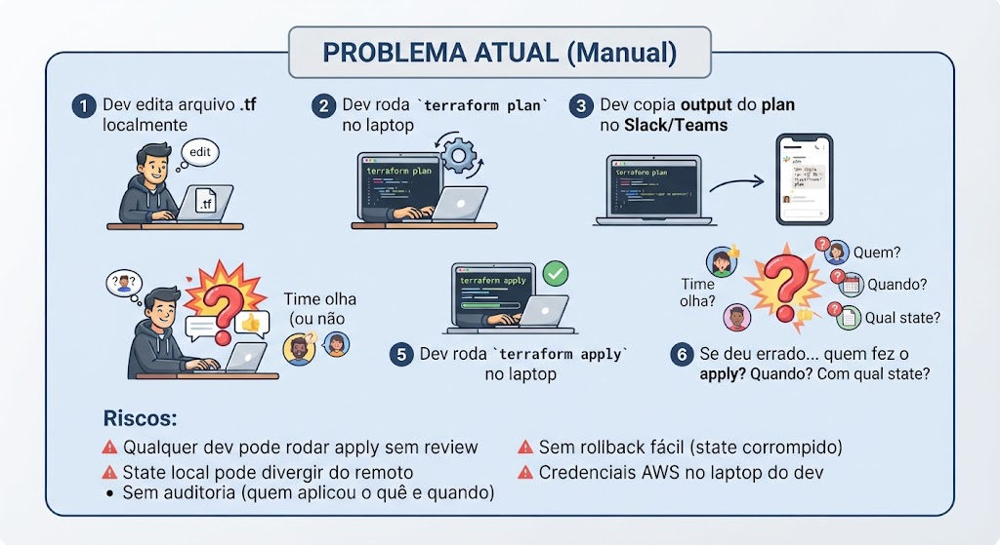
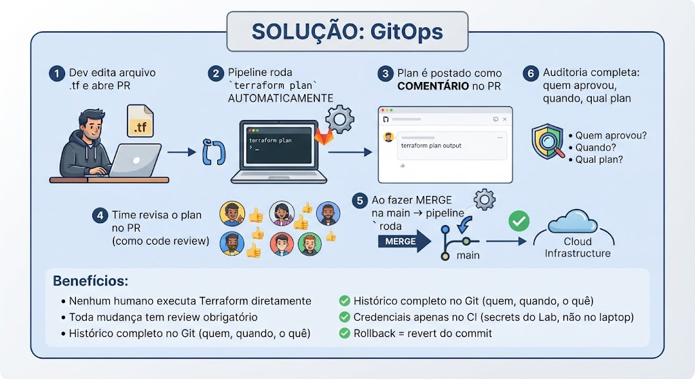
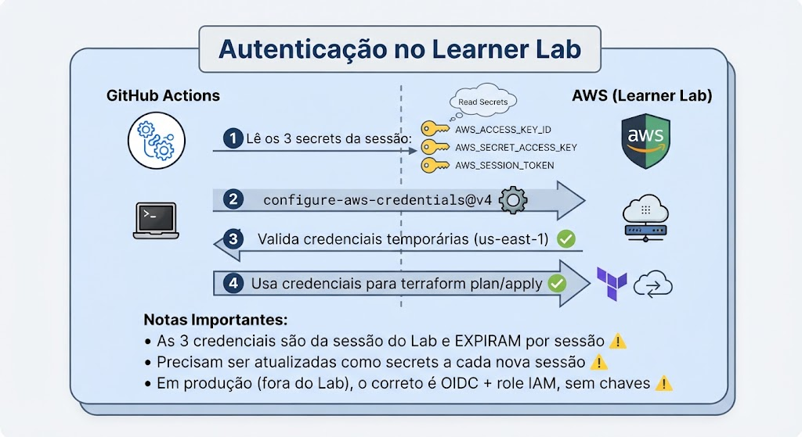
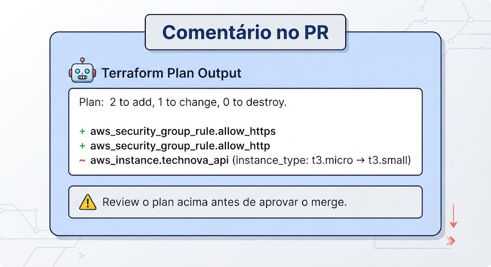
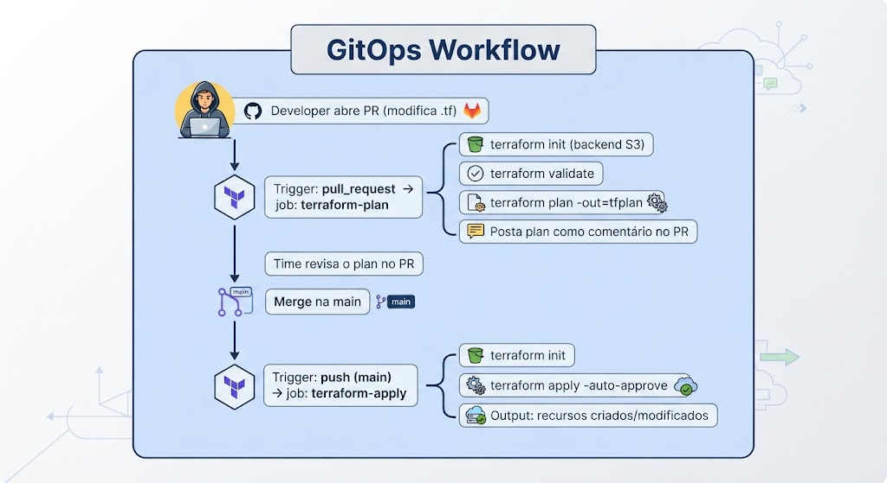
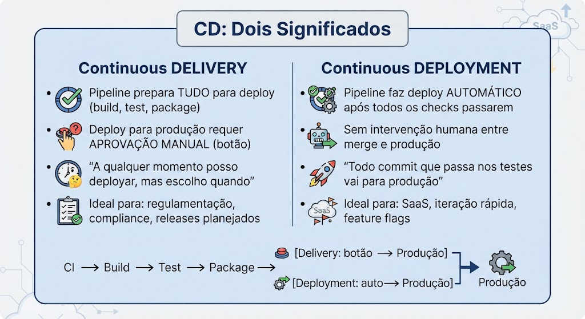
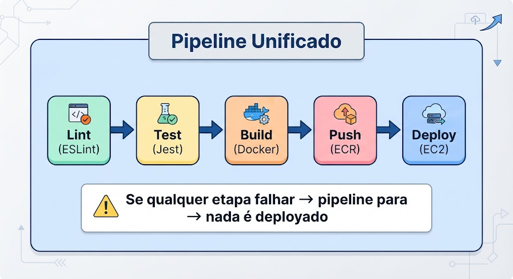
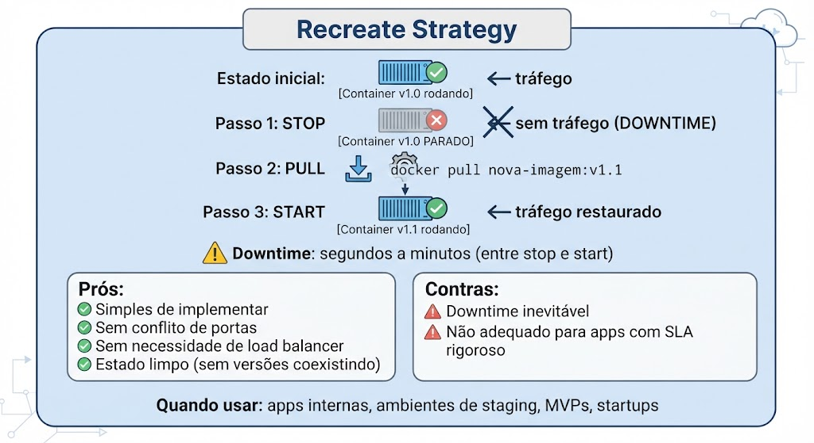

# Aula 10 — Terraform Automatizado e CD Pipelines

## Objetivos de Aprendizagem

Ao final desta aula, o aluno será capaz de:

1. Implementar o conceito de GitOps para gerenciar infraestrutura via Pull Requests
2. Configurar terraform plan automatizado como comentário em PRs
3. Configurar terraform apply automático ao fazer merge na branch main
4. Autenticar o GitHub Actions na AWS usando as credenciais temporárias de sessão do Learner Lab como secrets
5. Diferenciar Continuous Delivery de Continuous Deployment e aplicar CD em pipelines
6. Construir um pipeline unificado CI → Build → Push → Deploy
7. Implementar a estratégia de deploy Recreate (stop old → start new) via SSH em EC2
8. Configurar health checks e compreender o conceito de rollback manual

---

## Contexto Narrativo

> **O Resgate da TechNova — Episódio 10: "Do Manual ao Automático: Zero Intervenção Humana"**

Na reunião semanal da TechNova, Rafael trouxe uma frustração crescente:

> "Pessoal, toda vez que preciso mudar infraestrutura — adicionar uma variável de ambiente, mudar o tipo da instância, abrir uma porta no security group — eu tenho que logar na minha máquina, rodar terraform plan, mostrar o output no Slack, esperar aprovação, e aí rodar terraform apply. Se eu erro um `terraform apply` sem plan antes, posso derrubar produção. Já aconteceu."

Marina, a consultora, respondeu:

> "Esse é o problema clássico de Terraform manual. A solução se chama **GitOps para infraestrutura**: toda mudança vira um PR. O pipeline roda `terraform plan` automaticamente e posta o resultado como comentário no PR. O time revisa o plan. Ao fazer merge, o pipeline roda `terraform apply`. Nenhum humano executa Terraform direto. Zero intervenção."

O CTO Carlos Mendes completou:

> "E tem outro problema: o deploy da aplicação também é manual. O Rafael faz SSH no servidor, para o container, faz pull da nova imagem, e sobe de novo. Se ele estiver de férias, ninguém deploya. Preciso que o merge na main faça TUDO: teste, build, push da imagem e deploy automático no servidor."

Marina sorriu:

> "Isso é **Continuous Deployment** — o pipeline faz CI, builda a imagem, pusha para o registry e deploya automaticamente. Começamos com a estratégia mais simples: **Recreate** — para o container antigo, sobe o novo. Sem downtime complexo por enquanto, mas com verificação de saúde após o deploy."

Esse é o duplo desafio desta aula: automatizar Terraform com GitOps (plan no PR, apply no merge) E construir um pipeline CD completo que deploya automaticamente na EC2.

---

## Cronograma da Aula

| Bloco | Atividade |
|:-----:|-----------|
| 1 | Revisão TA + Discussão |
| 2 | Conteúdo Teórico — Terraform GitOps + CD Pipelines |
| 3 | Laboratório Parte 1 — Terraform Plan on PR + Apply on Merge |
| 4 | Laboratório Parte 2 — Pipeline CD Completo (CI→Build→Push→Deploy) |
| 5 | Encerramento + Orientação TF |

---

## Pré-requisitos

- **Conta GitHub** ativa (repositório público = Actions gratuito)
- **Acesso ao AWS Academy Learner Lab** (sessão iniciada, credenciais temporárias ativas, região `us-east-1`)
- **AWS CLI v2** instalada e configurada com as credenciais do Lab (`aws sts get-caller-identity` funcionando)
- **Terraform** instalado localmente (≥ 1.5) — [Download](https://developer.hashicorp.com/terraform/downloads)
- **Docker** instalado e funcionando (`docker --version`)
- **Node.js** instalado (≥ 18) — [Download](https://nodejs.org/)
- **Repositório `technova-api`** no GitHub com pipeline CI e imagens no **Amazon ECR** (Aula 09)
- **Infraestrutura Terraform** da TechNova provisionada (EC2 rodando, da Aula 08/09)
- **Conhecimentos das Aulas 01-09:** Git, Docker, Terraform (modules, remote state), VPC, EC2, GitHub Actions (CI completo, Docker Registry no ECR)

> **☁️ AWS Academy Learner Lab:** o laboratório autentica o GitHub Actions na AWS usando as **credenciais temporárias de sessão** do Lab (`AWS_ACCESS_KEY_ID`, `AWS_SECRET_ACCESS_KEY`, `AWS_SESSION_TOKEN`) armazenadas como GitHub Secrets. Elas **expiram quando o Lab encerra** — recarregue-as ao reabrir a sessão. Trabalhe sempre em `us-east-1`. O padrão ideal de produção (OIDC + role IAM, sem chaves) **não é possível no Lab**, porque o Lab não permite criar OIDC provider nem roles IAM.

---

## Conteúdo Teórico — Parte 1: Terraform Automatizado com GitOps

### 1. O Problema: Terraform Manual

Hoje na TechNova, o fluxo de mudanças de infraestrutura é:



### 2. GitOps para Infraestrutura

GitOps é o princípio de que **o repositório Git é a fonte da verdade** para toda infraestrutura:



### 3. Autenticação GitHub Actions → AWS no Learner Lab

O método tradicional de autenticar GitHub Actions na AWS usa access keys permanentes (de longa duração) armazenadas como secrets. Em produção, isso traz problemas:
- Chaves de longa duração (nunca expiram se não rotacionadas)
- Se vazarem, atacante tem acesso até serem revogadas
- Precisam ser rotacionadas manualmente

O **padrão ideal em produção** é **OIDC (OpenID Connect)**: o GitHub Actions pede um token temporário à AWS, que assume uma **role IAM** sem armazenar chave nenhuma. Porém esse padrão **exige criar um OIDC Identity Provider e uma role IAM**, o que o **AWS Academy Learner Lab não permite**.

**No Learner Lab**, a autenticação usa as **credenciais temporárias da sessão** como GitHub Secrets:



### 4. Plan como Comentário no PR

O output do `terraform plan` é postado diretamente no PR para review:



### 5. Fluxo Completo: PR → Plan → Review → Merge → Apply



---

## Conteúdo Teórico — Parte 2: CD Pipelines

### 1. Continuous Delivery vs Continuous Deployment



**Na TechNova:** Começamos com Continuous **Deployment** — merge na main deploya automaticamente. Simples e eficiente para uma startup.

### 2. Pipeline Unificado: CI → Build → Push → Deploy

O pipeline completo integra todas as etapas em um workflow:



### 3. Estratégia de Deploy: Recreate

Existem várias estratégias de deploy. A mais simples é **Recreate**:



### 4. Deploy via SSH em GitHub Actions

O pipeline se conecta à EC2 via SSH para executar comandos de deploy. Antes do `docker pull`, a EC2 faz login no **Amazon ECR** com um token temporário:

```yaml
- name: Deploy na EC2
  uses: appleboy/ssh-action@v1
  with:
    host: ${{ secrets.EC2_HOST }}
    username: ubuntu
    key: ${{ secrets.EC2_SSH_KEY }}
    script: |
      REGISTRY=${{ secrets.AWS_ACCOUNT_ID }}.dkr.ecr.us-east-1.amazonaws.com
      aws ecr get-login-password --region us-east-1 \
        | docker login --username AWS --password-stdin "$REGISTRY"
      docker pull "$REGISTRY/technova-api:latest"
      docker stop technova-api || true
      docker rm technova-api || true
      docker run -d --name technova-api \
        -p 3000:3000 \
        --restart unless-stopped \
        "$REGISTRY/technova-api:latest"
```

### 5. Health Check Após Deploy

Após o deploy, o pipeline verifica se a aplicação está respondendo:

```yaml
- name: Health Check
  run: |
    echo "Aguardando aplicação iniciar..."
    for i in $(seq 1 30); do
      if curl -s http://${{ secrets.EC2_HOST }}:3000/health | grep -q "ok"; then
        echo "✅ Aplicação saudável!"
        exit 0
      fi
      echo "Tentativa $i/30 - aguardando..."
      sleep 5
    done
    echo "❌ Health check falhou após 30 tentativas"
    exit 1
```

Se o health check falhar, o pipeline reporta erro — o time é notificado.

### 6. Rollback (Manual nesta etapa)

Nesta aula, rollback é manual mas documentado:

```bash
# Rollback manual: voltar para versão anterior
ssh ubuntu@EC2_HOST << 'EOF'
  REGISTRY=<ACCOUNT_ID>.dkr.ecr.us-east-1.amazonaws.com
  aws ecr get-login-password --region us-east-1 \
    | docker login --username AWS --password-stdin "$REGISTRY"
  docker stop technova-api
  docker rm technova-api
  docker run -d --name technova-api \
    -p 3000:3000 \
    --restart unless-stopped \
    "$REGISTRY/technova-api:sha-COMMIT_ANTERIOR"
EOF
```

> **💡 Em aulas futuras (Blue-Green, Canary), o rollback será automatizado.** Por agora, o importante é ter imagens versionadas no ECR para poder voltar.

### 7. Segurança do Pipeline de Deploy

| Preocupação | Solução |
|-------------|---------|
| Chave SSH exposta | Armazenada como GitHub Secret (criptografada) |
| Acesso irrestrito à EC2 | Security group libera SSH apenas do IP do runner |
| Credenciais AWS | Credenciais temporárias de sessão do Lab como secrets (em produção: OIDC + role IAM) |
| Imagem comprometida | Deploy apenas de imagens que passaram no CI |
| Deploy não-autorizado | Apenas push na main (merge requer aprovação) |

---

## Resumo dos Conceitos

| Conceito | Descrição |
|----------|-----------|
| GitOps | Infraestrutura gerenciada via Git — PR = change request |
| terraform plan on PR | Plan automático postado como comentário para review |
| terraform apply on merge | Apply automático quando PR é mergeado na main |
| Credenciais de sessão do Lab | 3 secrets temporários (key id, secret, session token) que expiram por sessão |
| OIDC | Autenticação federada GitHub↔AWS sem chaves — ideal em produção, indisponível no Lab |
| Continuous Delivery | Pipeline prepara deploy, humano aprova |
| Continuous Deployment | Pipeline deploya automaticamente após checks |
| Pipeline unificado | CI → Build → Push → Deploy em um workflow |
| Recreate strategy | Para container antigo, sobe novo (com downtime) |
| Deploy via SSH | GitHub Actions conecta na EC2 e executa comandos |
| Login ECR no deploy | `aws ecr get-login-password` antes do `docker pull` |
| Health check | Verificação pós-deploy se a app está respondendo |
| Rollback | Voltar para versão anterior (manual nesta etapa) |
| appleboy/ssh-action | Action para executar comandos via SSH |
| -auto-approve | Flag que pula confirmação interativa do apply |

---

## Custo

| Serviço | Custo |
|---------|:-----:|
| GitHub Actions (minutos) | **$0.00** (repo público) |
| Amazon ECR (registry) | ~$0.10/GB/mês (coberto pelos créditos do Lab) |
| EC2 t3.micro (destino do deploy) | Coberto pelos créditos do Lab |
| S3 (Terraform state) | ~$0.02/mês (coberto pelos créditos do Lab) |

> **☁️ No AWS Academy Learner Lab os custos de ECR, EC2 e S3 são cobertos pelos créditos do Lab.** Rode `terraform destroy` ao final da sessão para liberar os recursos.

---

*Próximas etapas: Laboratório Parte 1 (Terraform GitOps) → Laboratório Parte 2 (CD Pipeline) → TF (Trabalho de Fixação)*
