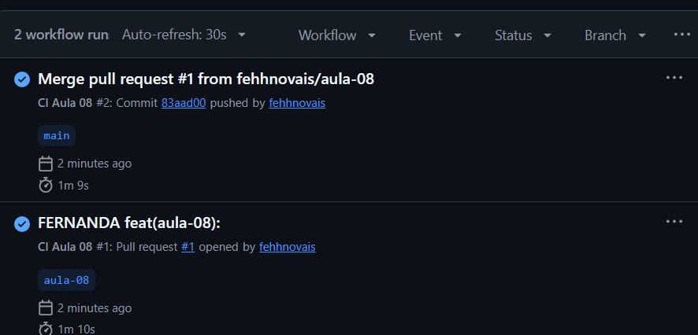
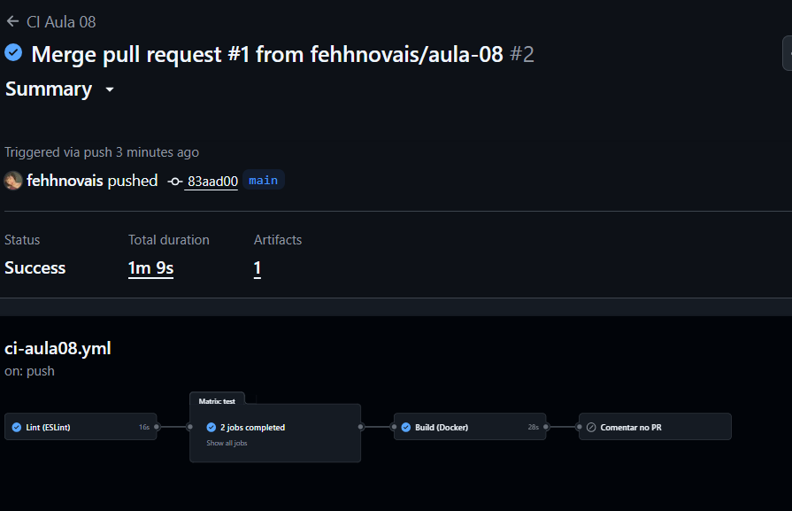
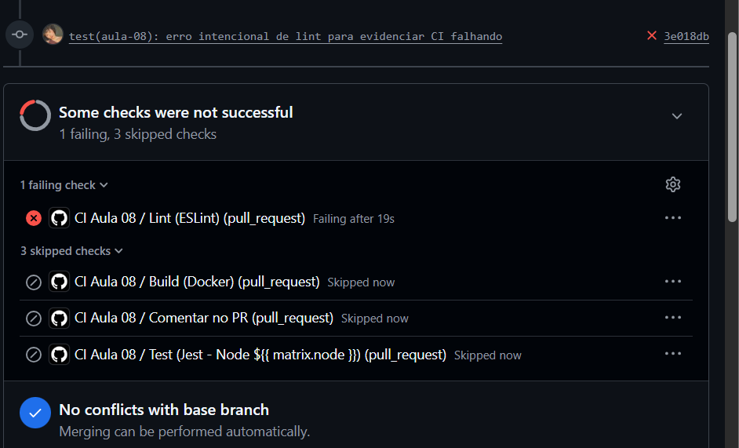

# Entrega — Aula 08: GitHub Actions e CI Pipelines

**Aluno:** FERNANDA TAVARES
**RA:** 4025109
**Data:** 20/10/2026

## Repositório

- URL: https://github.com/fehhnovais/unifaat-devops-portfolio

## Evidências

- [x] Workflow CI multi-stage funcional (lint → test → build)
- [x] ESLint configurado e passando
- [x] Mínimo 3 testes Jest passando com coverage
- [x] Docker build no CI sem erros
- [x] Secret referenciado no workflow
- [x] Badge de status no README
- [x] Screenshots do pipeline verde

## Evidência do Pipeline Rodando

