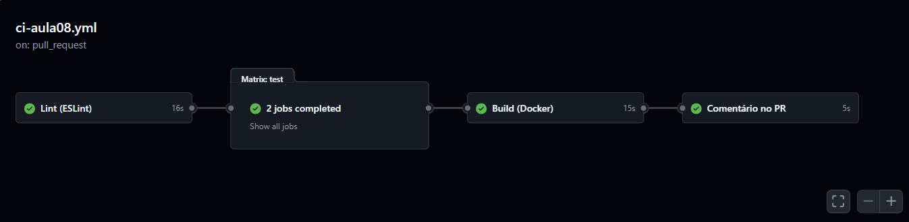
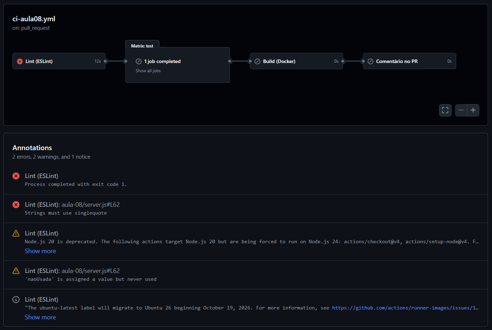
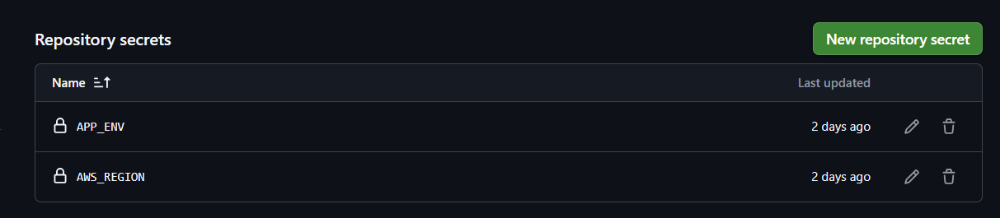

# Entrega — Aula 08: GitHub Actions e CI Pipelines

**Aluno:** Gabriel Reis Cunha
**RA:** 6325149
**Data:** 14/10/2026

## Repositório

- URL: https://github.com/gabrielreis354/unifaat-devops-portfolio
- Aplicação: [`aula-08/technova-api/`](https://github.com/gabrielreis354/unifaat-devops-portfolio/tree/main/aula-08/technova-api) · Workflow: [`.github/workflows/ci-aula08.yml`](https://github.com/gabrielreis354/unifaat-devops-portfolio/blob/main/.github/workflows/ci-aula08.yml) · Respostas: [`aula-08/RESPOSTAS.md`](https://github.com/gabrielreis354/unifaat-devops-portfolio/blob/main/aula-08/RESPOSTAS.md)
- Badge (README): [](https://github.com/gabrielreis354/unifaat-devops-portfolio/actions/workflows/ci-aula08.yml)

## Evidências

- [x] Workflow CI multi-stage funcional (lint → test → build)
- [x] ESLint configurado e passando
- [x] Mínimo 3 testes Jest passando com coverage (9 testes, `/health` e `/api/orders`)
- [x] Docker build no CI sem erros
- [x] Secret referenciado no workflow
- [x] Badge de status no README
- [x] Screenshots do pipeline verde

Bônus: matrix Node 18/20 (B1), cache do npm (B2), comentário automático no PR (B3), `concurrency` com cancelamento (B4) e smoke test no Docker (B5).

### Workflow (R1)

`lint` → `test` (`needs: lint`) → `build` (`needs: [lint, test]`), mais `pr-comment` só em `pull_request`. Triggers: `push` (main), `pull_request` e `workflow_dispatch`.

### ESLint (R2) — `aula-08/technova-api/.eslintrc.json`

```json
"rules": {
  "no-unused-vars": ["warn", { "argsIgnorePattern": "^_" }],
  "semi": ["error", "always"],
  "quotes": ["error", "single"],
  "indent": ["error", 2],
  "no-trailing-spaces": "error",
  "eol-last": ["error", "always"]
}
```

Script no `package.json`: `"lint": "eslint ."`. O run vermelho (PR #2) prova que a regra bloqueia: `Strings must use singlequote`.

### Testes Jest (R3) — `package.json`: `"test:ci": "jest --coverage --forceExit --ci"`

```
Health Check
  ✓ GET /health deve retornar status 200
  ✓ GET /health deve retornar status ok
  ✓ GET /health deve retornar timestamp
Orders API
  ✓ GET /api/orders deve retornar array
  ✓ GET /api/orders deve retornar orders com campos corretos
  ✓ GET /api/orders/:id deve retornar order específica
  ✓ GET /api/orders/:id deve retornar 404 para id inexistente
  ✓ POST /api/orders deve criar nova order
  ✓ POST /api/orders deve retornar 400 sem campos obrigatórios
Tests: 9 passed, 9 total

All files  | % Stmts 89.28 | % Branch 66.66 | % Funcs 83.33 | % Lines 88.88
```

Executado no CI em Node 18 e Node 20 (`Tests: 9 passed, 9 total` nos dois jobs); o coverage é publicado como artifact.

### Docker (R4) — `aula-08/technova-api/Dockerfile`

```dockerfile
FROM node:20-alpine AS base
WORKDIR /app
COPY package*.json ./
RUN npm ci --only=production

FROM base AS production
COPY . .
EXPOSE 3000
USER node
CMD ["node", "server.js"]
```

No CI: `docker build -t technova-api:${{ github.sha }} .`, seguido de smoke test (`docker run -d`, `curl -f /health` em loop e `docker rm -f` com `if: always()`).

### Secret (R5) e cache (B2) — trecho do log do run 38651587323

```
Lint (ESLint)   Verificar secret configurado   AWS_REGION=***
Lint (ESLint)   Setup Node.js                  Cache restored successfully
Tests (Node 18) Setup Node.js 18               Cache restored successfully
Tests (Node 20) Setup Node.js 20               Cache restored successfully
```

Secrets cadastrados no repositório: `AWS_REGION` e `APP_ENV` (valores fictícios, ocultos na tela de Secrets).

## Evidência do Pipeline Rodando

| Evidência | Link |
|-----------|------|
| Run verde na `main` (após organizar `aula-08/technova-api/`) | https://github.com/gabrielreis354/unifaat-devops-portfolio/actions/runs/38651587323 |
| Run verde na `main` (merge do PR #1) | https://github.com/gabrielreis354/unifaat-devops-portfolio/actions/runs/38052653675 |
| Run verde no PR #1 (com comentário do bot, B3) | https://github.com/gabrielreis354/unifaat-devops-portfolio/actions/runs/37866153127 |
| Run cancelado por `concurrency` (B4) | https://github.com/gabrielreis354/unifaat-devops-portfolio/actions/runs/37866269577 |
| Run vermelho (erro de lint intencional, PR #2 fechado sem merge) | https://github.com/gabrielreis354/unifaat-devops-portfolio/actions/runs/38053050760 |
| PR #1 / PR #4 (mudança de estrutura) | https://github.com/gabrielreis354/unifaat-devops-portfolio/pull/1 · https://github.com/gabrielreis354/unifaat-devops-portfolio/pull/4 |

### Screenshots






